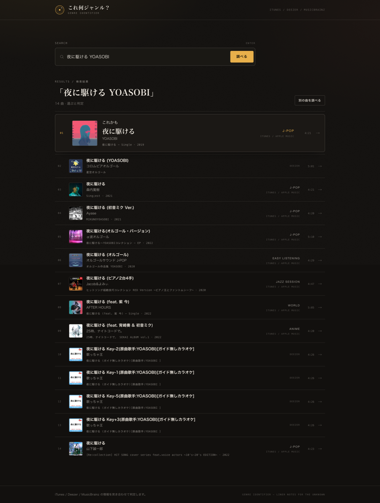

# これ何ジャンル？

曲名・音声ファイル・Spotify / YouTube のリンクから、その曲のジャンルを根拠つきで判定する Web アプリです。




- 公開先（Cloudflare Pages）: <https://genre.slytxt.dev>
- 予備の URL: <https://genre-finder.pages.dev>
- 構成: Vite + React + TypeScript / Cloudflare Pages Functions / pnpm

## 何ができるか

ジャンル名がわからない曲を、3つの入口から調べられます。

| 入口 | 入力するもの |
| --- | --- |
| 曲名で検索 | 「曲名」または「曲名 アーティスト」 |
| リンクを貼る | Spotify / YouTube / Apple Music / Deezer の曲ページの URL |
| 音声ファイル | MP3 などのタグ、タグが無ければファイル名 |

判定結果は、beatmania IIDX のジャンル表示のように、全大文字のジャンル名を主役にして出します。その下に `LV.xx`（信頼度の目盛り）、`SPECTRUM`（マルチジャンルの混ざり具合）、`DATA FEED`（どのソースが何と言ったか）、`TAGS`、`RELATED` が並びます。どのソースも分類できない場合は「判定不能」と表示します。

ゲーム音楽と判定できた曲は、ジャンル名の下に `WORK / UNDERTALE` のような作品名も出ます（CHIPTUNE / FM SYNTH / RHYTHM GAME / TOUHOU / VISUAL NOVEL など）。東方アレンジはサークル名（SOUND HOLIC / IOSYS 等）やイベント名（例大祭 等）、音ゲーは BEMANI / SOUND VOLTEX / プロセカ などの語からも検出します。

URLを共有するとOGPカードが表示され、スマホのホーム画面にも追加できます（manifest）。

判定画面では **30秒試聴**（iTunes / Deezer のプレビュー音源）ができ、ゲーム作品名は Apple Music の検索にリンクします。調べた曲は **RECENT** としてトップページに残り、**RANDOM** でおまかせ選曲もできます。判定結果の URL は `?t=曲名&a=アーティスト` の形になるので、そのまま共有すると開いた人にも同じ判定が出ます。

## 使い方

1. 曲名を入力するか、リンクを貼るか、音声ファイルを選ぶ。
2. 候補一覧から、調べたい曲を選ぶ。
3. 判定結果の信頼度と根拠を見る。

詳しい操作と結果の読み方は [docs/USAGE.md](docs/USAGE.md) にあります。

## 判定の仕組み

ブラウザから Cloudflare Pages Functions の API を呼び、Functions が外部 API をまとめて叩きます。外部 API のキーをブラウザに出さず、CORS も避けられます。

```
ブラウザ（React）
  │ GET /api/search, /api/analyze, /api/resolve
  ▼
Cloudflare Pages Functions
  ├─ iTunes Search API   曲の公式ジャンル
  ├─ Deezer API          アルバムのジャンル
  ├─ MusicBrainz API     コミュニティのタグ・ジャンル
  └─ Last.fm / Spotify   シークレットを設定したときだけ
```

判定は4段階です。

| 段階 | やること |
| --- | --- |
| 検索 | iTunes と Deezer から曲の候補を集める |
| 証拠集め | 選んだ曲のジャンル・タグを各ソースから取る |
| 正規化 | 表記ゆれを共通のジャンル ID に寄せる（"J-Pop" と "Japanese Pop" など） |
| 集計 | 証拠の重みを合計し、ジャンルごとの信頼度を出す |

証拠の重みはソースごとに変えています。

| 証拠 | 重み |
| --- | --- |
| iTunes の `primaryGenreName` | 0.90 |
| Deezer のアルバムジャンル | 0.75 |
| MusicBrainz のアーティストジャンル | `0.45 + 0.55 × min(投票数 / 25, 1)` |
| MusicBrainz のレコーディングタグ | 上記 × 0.9 |
| Last.fm のタグ | `0.40 + 0.60 × min(投票数 / 100, 1)` |

信頼度は「そのジャンルを支持する重み ÷ 全証拠の重み」です。2ソース以上が同じジャンルを支持したら少し底上げします。0.6 以上を「高」、0.35 以上を「中」、それ未満を「低」、証拠が無い場合を「判定不能」として表示します。

単一ソースでは足りません。iTunes は1曲に "Pop" のような粗いラベルを1つ返すだけです。MusicBrainz は "french house" のような細かいタグを持つ代わりに、タグが付いていない曲も多くあります。Deezer のジャンルはアルバム単位なので、曲のジャンルと一致するとは限りません。3つを突き合わせると、粗いラベルを細かいタグで補え、一致したときは根拠が強くなり、対立したときは信頼度が下がります。

## ローカルで動かす

Node.js 20 以上と pnpm が必要です（`package.json` の `engines` は `>=20`、CI は Node 22）。

```bash
pnpm install
pnpm dev
```

<http://localhost:5173> が開きます。`/api/*` は Vite の開発サーバー上で Functions がそのまま動きます（`scripts/dev-api-plugin.ts`）。ポートを変える場合は `pnpm dev --port 5180` のように指定します。

シークレットは任意です。設定する場合は `.dev.vars.example` をコピーして値を入れます。未設定のままでも iTunes・Deezer・MusicBrainz で動きます。

```bash
cp .dev.vars.example .dev.vars
```

検査とビルドは次のコマンドで実行します。

```bash
pnpm typecheck   # 型チェック
pnpm test        # Vitest
pnpm build       # 型チェック + Vite ビルド（dist/）
pnpm preview:cf  # ビルドして Cloudflare のランタイムで確認
```

`pnpm preview:cf` は `dist/` を `wrangler pages dev` で配信し、<http://localhost:8788> で確認できます。

GitHub に push するか pull request を作ると、`.github/workflows/ci.yml` が型チェック・テスト・ビルドを実行します。

## Cloudflare Pages へデプロイ

Wrangler でログインし、Pages プロジェクトを1回だけ作成してからデプロイします。

```bash
pnpm exec wrangler login
pnpm exec wrangler pages project create genre-finder --production-branch main
pnpm deploy
```

`pnpm deploy` はビルドして `wrangler pages deploy dist --project-name genre-finder --branch main` を実行します。公開 URL は <https://genre.slytxt.dev>（予備: <https://genre-finder.pages.dev>）です。

GitHub への push で自動デプロイする設定、シークレットの登録、カスタムドメイン、ロールバックは [docs/DEPLOY.md](docs/DEPLOY.md) にまとめています。

## 任意のシークレット

| 名前 | 設定すると | 未設定のとき |
| --- | --- | --- |
| `SPOTIFY_CLIENT_ID` / `SPOTIFY_CLIENT_SECRET` | Spotify のリンクを API で正確に解決する | oEmbed と埋め込みページから曲名・アーティストを推定する |
| `LASTFM_API_KEY` | Last.fm のタグを追加の証拠に使う | Last.fm を使わない |

本番の値は Wrangler で登録します。値はプロンプトで聞かれるので、コマンドラインには書きません。

```bash
pnpm exec wrangler pages secret put SPOTIFY_CLIENT_ID --project-name genre-finder
pnpm exec wrangler pages secret put SPOTIFY_CLIENT_SECRET --project-name genre-finder
pnpm exec wrangler pages secret put LASTFM_API_KEY --project-name genre-finder
```

## 制限事項

- 音声そのものは解析しません。音声ファイルはタグとファイル名だけを使います。テンポ・音色・コード進行は判定材料にしていません。
- iTunes・Deezer・MusicBrainz に登録が無い曲は、候補が出ないか信頼度が低くなります。インディーズ、DJ エディット、同人、配信限定の曲は当てはまりやすいです。
- iTunes のジャンルは粗く、1曲に1ラベルしかありません。"Pop" しか付いていない曲は、細分類を他ソースのタグに頼ります。
- MusicBrainz のタグはコミュニティの編集に依存します。洋楽の有名曲に偏り、日本語曲はタグが薄いことが多いです。
- ジャンルの境界は曖昧で、正解が1つに決まりません。このアプリが表示するのは複数ソースの一致度であって、音楽的な断定ではありません。
- 外部 API が応答しない、またはレート制限に当たった場合、そのソースを使わずに判定します。結果画面に失敗したソースを表示します。
- Spotify と Last.fm はシークレットが無ければ使いません。また、検索結果やタグは各サービスのデータ更新に依存します。

## データの出典と利用条件

判定には次の API を使っています。データの権利は各提供元に帰属します。

| 提供元 | 使うデータ | 条件 |
| --- | --- | --- |
| [Apple iTunes Search API](https://performance-partners.apple.com/search-api) | 曲名・アーティスト・アルバム・ジャンル・アートワーク | 約20リクエスト/分の制限があり、キャッシュが推奨されている。アートワークなどプロモーション用コンテンツの利用は Apple の規約に従う |
| [Deezer API](https://developers.deezer.com/api) | アルバムのジャンル | 利用は非商用に限られる（Deezer の API 利用規約） |
| [MusicBrainz](https://musicbrainz.org/doc/MusicBrainz_API) | アーティスト・レコーディングのタグとジャンル | コアデータは CC0、補助データは CC BY-NC-SA 3.0。API は User-Agent の提示と1秒1リクエストの制限がある |
| [Last.fm](https://www.last.fm/api) | 曲のトップタグ（任意） | 非商用利用に限られ、クレジットとリンク、キャッシュが求められる |
| [Spotify](https://developer.spotify.com/) | リンク解決（任意） | Spotify Developer Terms に従う |
| [YouTube](https://www.youtube.com/) | oEmbed のタイトルでリンク解決 | YouTube の利用条件に従う |

## ドキュメント

| ファイル | 内容 |
| --- | --- |
| [docs/USAGE.md](docs/USAGE.md) | 使い方、結果の読み方、よくある質問 |
| [docs/DEPLOY.md](docs/DEPLOY.md) | Cloudflare Pages へのデプロイ、シークレット、自動デプロイ、ロールバック |
| [docs/ARCHITECTURE.md](docs/ARCHITECTURE.md) | 構成、判定アルゴリズム、キャッシュ、ソースの追加手順 |

## ライセンス

コードは MIT ライセンスです（`LICENSE`）。API から取得するデータは、上記の各提供元の条件に従います。
